# HireNova – Find Your Next Opportunity

[](https://www.python.org/)
[](https://flask.palletsprojects.com/)
[](https://www.sqlite.org/)
[](https://getbootstrap.com/)
[](https://developer.mozilla.org/)
[](#automated-test-suite)
[](LICENSE)

> **Individual Minor Project Submission for Internship Requirements**  
> **Developed by:** Chethan S | Academic Year 2026

---

## 1. Project Overview

**HireNova** is an asynchronous Online Job Portal Web Application designed to streamline recruitment for candidates and hiring managers alike. Built using a lightweight **Python Flask** REST backend, a normalized **SQLite** database, and a responsive **HTML5 / CSS3 / Bootstrap 5 / JavaScript** frontend, the platform provides seamless job discovery, one-click applications with duplicate prevention, real-time application tracking, and an administrative control panel.

### Core Value Proposition
- **Jobseekers**: Explore career openings, search by keywords or location, view comprehensive job specifications, apply instantly, and track application review stages (`Pending`, `Shortlisted`, `Rejected`).
- **Recruiters & Admins**: Publish open positions, edit/delete listings, review candidate submissions in one place, and update application statuses with immediate reflection on candidate dashboards.

---

## 2. Technologies Used

| Technology | Category | Purpose & Implementation |
|---|---|---|
| **Python 3.13** | Backend Language | Core application runtime, business logic, and API controllers. |
| **Flask 3.1.3** | Web Framework | Routing, WSGI server interface, JSON serialization, and Jinja2 templating. |
| **SQLite 3** | Database | Embedded relational database with foreign keys and composite unique constraints. |
| **Werkzeug Security** | Cryptography | Secure password hashing using PBKDF2/SHA256 and verification. |
| **HTML5 & Jinja2** | Markup & Templates | Semantic layout, component blocks, and layout inheritance (`base.html`). |
| **CSS3 & Bootstrap 5.3** | Design & Styling | Dark-themed responsive UI, interactive modals, and mobile-friendly layouts. |
| **JavaScript (ES6+)** | Frontend Scripting | Asynchronous API communication via `fetch()`, DOM updates, and live search. |
| **Git & GitHub** | Version Control | Multi-branch workflow (`main`, `dev`, `feature/*`) and commit traceability. |
| **unittest** | Software Testing | Automated regression test suite covering authentication, CRUD, and constraints. |

---

## 3. Key Features & Module Breakdown

### 3.1 Candidate / Jobseeker Experience
- **Secure Authentication**: Registration and login with client- and server-side validation and secure password hashing.
- **Dynamic Job Search**: Instant keyword filtering across titles, companies, and role descriptions.
- **Role Specifications**: Modal popup displaying compensation, location, and detailed job expectations.
- **Single-Click Application**: Candidates submit applications instantly using their active session credentials.
- **Duplicate Prevention**: Database-level constraints ensure applicants cannot apply multiple times to the same position.
- **Application Tracking ("My Applications")**: Dedicated dashboard displaying applied jobs and real-time review status (`Pending`, `Shortlisted`, `Rejected`).
- **Self-Service Password Recovery**: Secure tokenized password recovery workflow.

### 3.2 Administrator Control Center
- **Role-Based Protection**: Admin routes protected by session validation (`role == 'admin'`).
- **Job Postings Management**: Full CRUD capabilities to create, edit, and delete job postings.
- **Candidate Submission Review**: Comprehensive view of all candidate applications with applicant contact information.
- **Status Lifecycle Control**: Instant status updates (`Pending`, `Shortlisted`, `Rejected`) visible directly to applicants.

---

## 4. System Architecture

HireNova is designed as a **3-Tier Client-Server Architecture**:

```
+--------------------------------------------------------------------------+
|                         Presentation Layer (Client)                      |
|      HTML5  *  CSS3 (Custom Dark Theme)  *  Bootstrap 5.3  *  ES6 JS     |
|      Single-Page Application (SPA) Views & Asynchronous Fetch Calls      |
+------------------------------------+-------------------------------------+
                                     |  HTTP REST (JSON)
+------------------------------------v-------------------------------------+
|                         Application Layer (Server)                       |
|                     Python 3.13  *  Flask 3.1.3                          |
|   - Authentication & Session Guard    - Job Listings CRUD Controller     |
|   - Applications & Duplicate Guard    - Password Reset Token Manager     |
+------------------------------------+-------------------------------------+
                                     |  Parameterized SQL
+------------------------------------v-------------------------------------+
|                            Data Layer (Database)                         |
|                         SQLite 3 (hirenova.db)                           |
|       [users]  <--1:N-->  [applications]  <--N:1-->  [jobs]              |
|       [users]  <--1:1-->  [password_resets]                              |
+--------------------------------------------------------------------------+
```

*For in-depth architectural sequence diagrams, component breakdowns, and ER diagrams, see [ARCHITECTURE.md](docs/ARCHITECTURE.md).*

---

## 5. Project Directory Structure

```
HireNova/
├── run.py                          # Primary server launcher (`python run.py`)
├── app.py                          # Backward-compatibility runner (`python app.py`)
├── database.py                     # Root database proxy
├── requirements.txt                # Python package dependencies
├── .gitignore                      # Git exclusion rules (venv, *.db, cache)
├── README.md                       # Main repository documentation
│
├── src/                            # Core Application Package
│   ├── __init__.py                 # Package initializer
│   ├── app.py                      # Flask RESTful API & route controllers
│   ├── database.py                 # SQLite connection & table creation
│   ├── templates/                  # Jinja2 presentation templates
│   │   ├── base.html               # Shared navbar, container, and footer layout
│   │   └── home.html               # Main SPA interface & client scripts
│   └── static/                     # Static frontend assets
│       ├── css/
│       │   └── style.css           # Custom theme and responsive stylesheet
│       ├── js/                     # Custom JavaScript modules
│       └── images/                 # Static graphical assets
│
├── scripts/                        # Utility & Seeding Scripts
│   ├── __init__.py
│   ├── create_admin.py             # Interactive CLI admin user creation
│   ├── migrate_db.py               # Database schema migration script
│   └── seed_data.py                # Realistic demo data seeder (jobs, users, apps)
│
├── tests/                          # Automated Test Suite
│   ├── __init__.py
│   └── test_app.py                 # 9 unit & integration tests (Auth, Jobs, Apps)
│
├── docs/                           # Comprehensive Project Documentation
│   ├── Project_Documentation.md    # Detailed internship project report
│   ├── ARCHITECTURE.md             # System architecture & sequence diagrams
│   └── API_REFERENCE.md            # Complete REST API specification
│
└── assets/
    └── screenshots/                # Output screenshots & UI evidence
        ├── 01_landing_hero.png
        ├── 02_job_search_filters.png
        ├── 03_job_details_modal.png
        ├── 04_user_registration.png
        ├── 05_user_login.png
        ├── 06_job_application_submission.png
        ├── 07_duplicate_application_prevention.png
        ├── 08_my_applications_status_tracking.png
        ├── 09_admin_dashboard_overview.png
        ├── 10_admin_post_new_job.png
        ├── 11_admin_update_application_status.png
        ├── 12_password_reset_flow.png
        └── README.md
```

---

## 6. Installation & Setup Instructions

### Prerequisites
- **Python 3.10+** (Tested on Python 3.13)
- **Git**

### Step-by-Step Setup

1. **Clone the Repository**
   ```bash
   git clone <repository-url>
   cd HireNova
   ```

2. **Create and Activate a Virtual Environment**
   - **Windows (PowerShell)**:
     ```powershell
     python -m venv venv
     .\venv\Scripts\Activate.ps1
     ```
   - **Linux / macOS**:
     ```bash
     python3 -m venv venv
     source venv/bin/activate
     ```

3. **Install Dependencies**
   ```bash
   pip install -r requirements.txt
   ```

4. **Seed Sample Data (Recommended for Demo & Evaluation)**
   Populate realistic demo job postings, candidates, and review statuses:
   ```bash
   python scripts/seed_data.py
   ```
   *Demo Accounts Generated:*
   - **Administrator**: `admin@hirenova.com` | Password: `adminpassword123`
   - **Jobseeker**: `jane@example.com` | Password: `jobseekerpass123`

   *(Alternatively, create a fresh custom admin account with `python scripts/create_admin.py`).*

5. **Start the Web Application**
   ```bash
   python run.py
   ```
   *(Or alternatively: `python app.py`)*

6. **Open in Browser**
   Navigate to:
   ```
   http://127.0.0.1:5000
   ```

---

## 7. Automated Test Suite

HireNova includes an automated regression test suite using Python's standard `unittest` framework. The tests run against an isolated temporary database, ensuring zero contamination of production/demo data.

To execute all tests:
```bash
python -m unittest tests/test_app.py
```

### Test Coverage Highlights
- `test_01_home_page_loads`: Confirms homepage renders successfully (HTTP 200).
- `test_02_registration_success`: Validates account creation (HTTP 201).
- `test_03_registration_duplicate_email`: Enforces unique email constraint (HTTP 409).
- `test_04_registration_password_length`: Validates 8-character password policy (HTTP 400).
- `test_05_login_and_logout_flow`: Checks session cookie establishment and clearance.
- `test_06_jobs_listing_and_search`: Tests live keyword and location queries.
- `test_07_job_application_flow`: Confirms job application submission (HTTP 201).
- `test_08_duplicate_application_prevention`: Blocks duplicate submissions (HTTP 409).
- `test_09_admin_job_crud_and_status_update`: Validates role enforcement and job management.
- `test_10_forgot_and_reset_password`: Tests cryptographic token generation and password updates.

---

## 8. Output Screenshots & UI Gallery

The platform interface is validated across desktop and mobile devices. Full resolution placeholders and captured assets are located in [`assets/screenshots/`](assets/screenshots/):

| View | Screenshot Artifact | Description |
|---|---|---|
| **Landing Hero** | 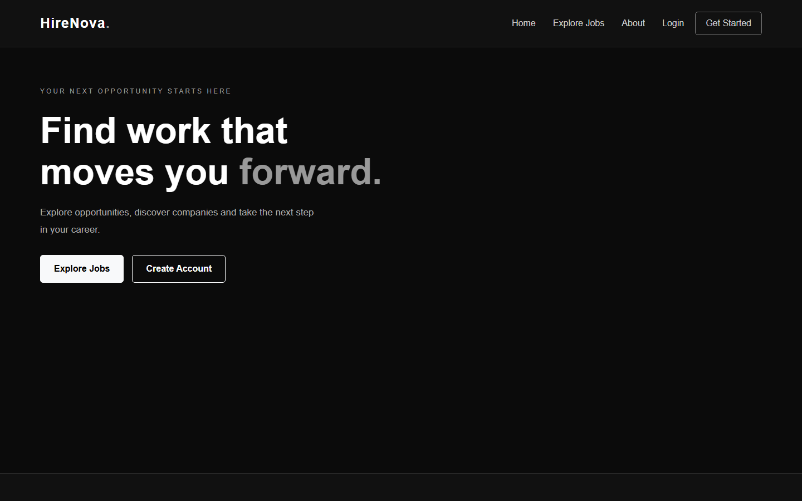 | Homepage featuring headline call-to-action buttons and navigation. |
| **Job Search** | 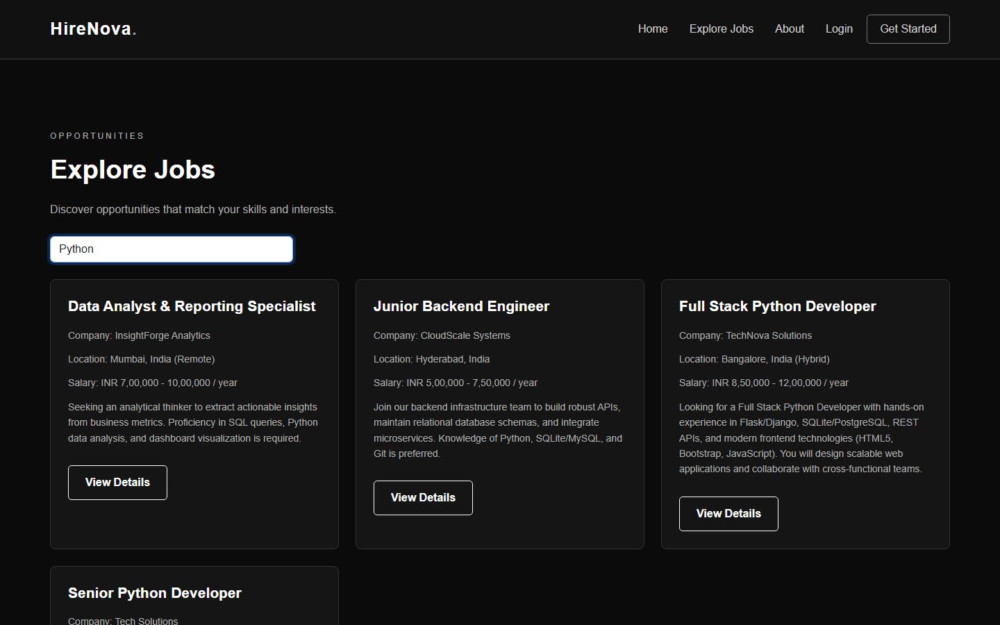 | Real-time filtered job cards with compensation and location tags. |
| **Job Details Modal** | 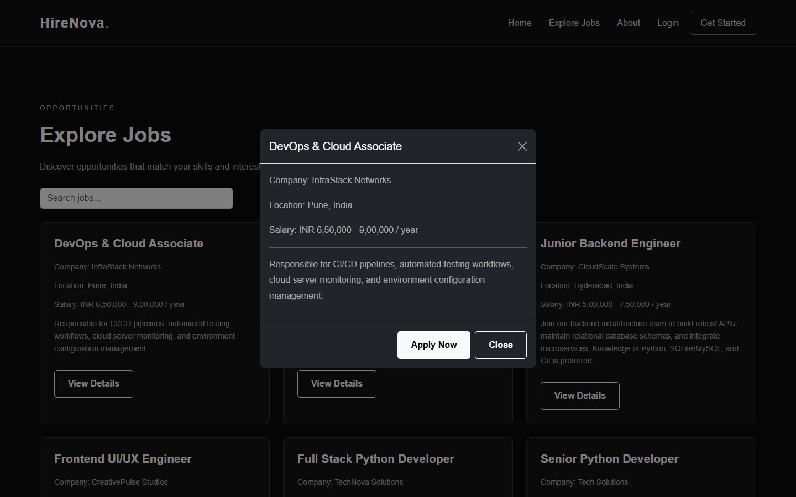 | Modal displaying complete position specifications and "Apply" button. |
| **User Registration** | 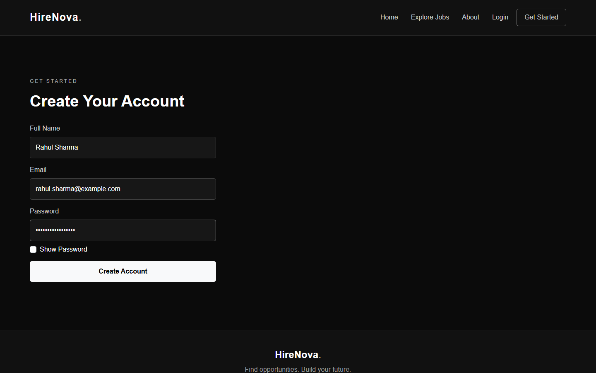 | Candidate registration form with input validation. |
| **User Login** | 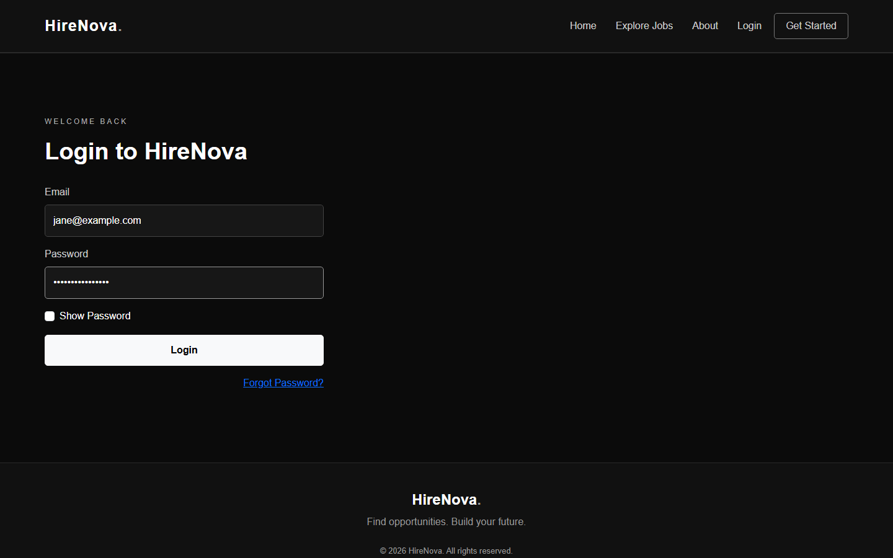 | Session authentication dialog. |
| **Application Success** |  | Feedback alert confirming candidate application submission. |
| **Duplicate Prevention** | 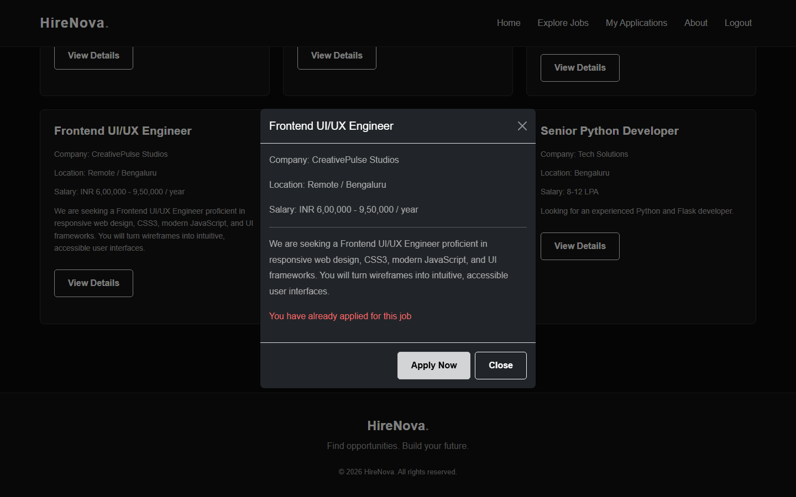 | System alert preventing double submissions for the same role. |
| **My Applications** | 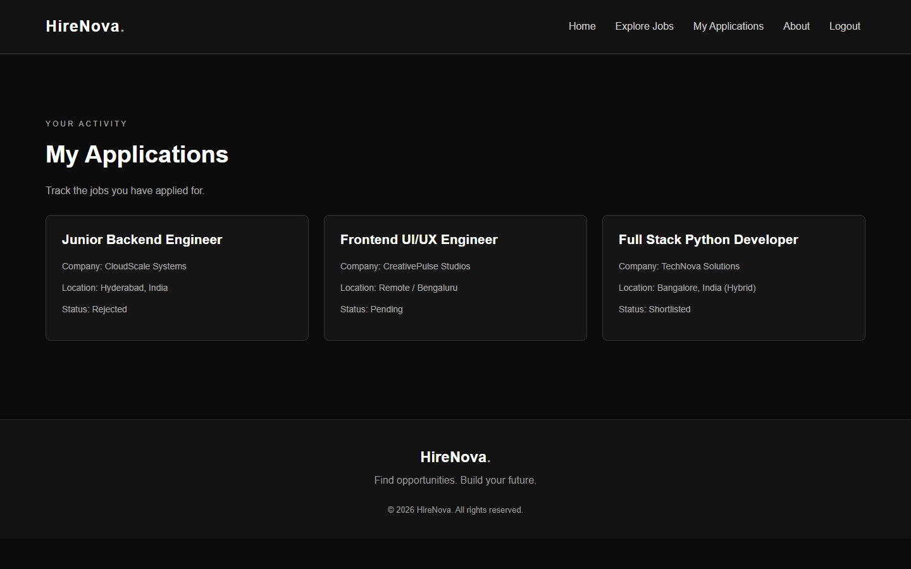 | Candidate status dashboard (`Pending`, `Shortlisted`, `Rejected`). |
| **Admin Dashboard** | 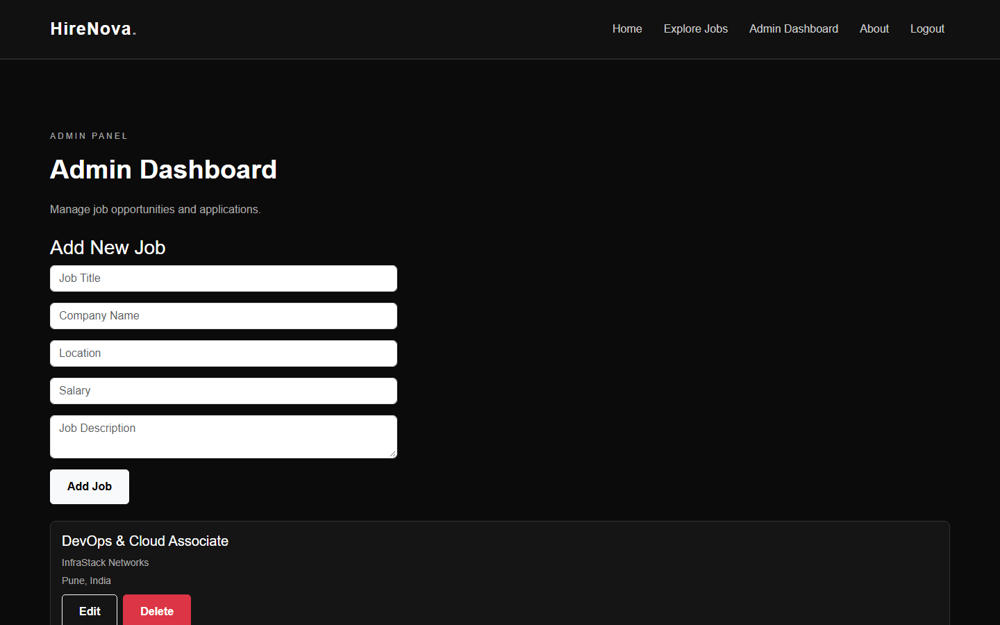 | Recruiter control panel displaying all received applications. |
| **Post/Edit Job** | 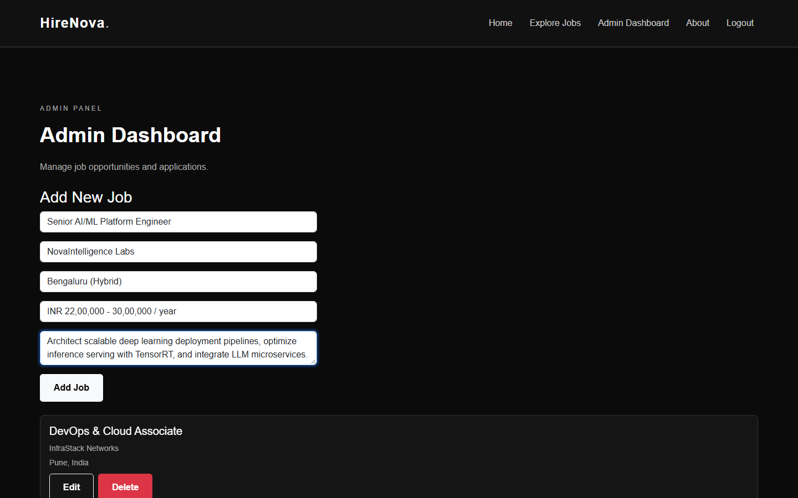 | Administrative form for posting new job openings. |
| **Update Status** | 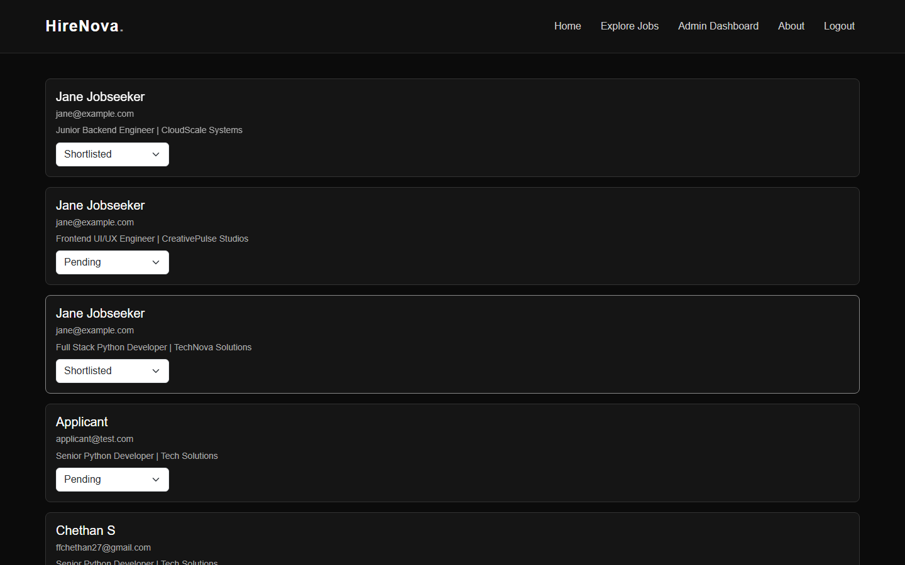 | Real-time candidate review status transition controls. |
| **Password Reset** | 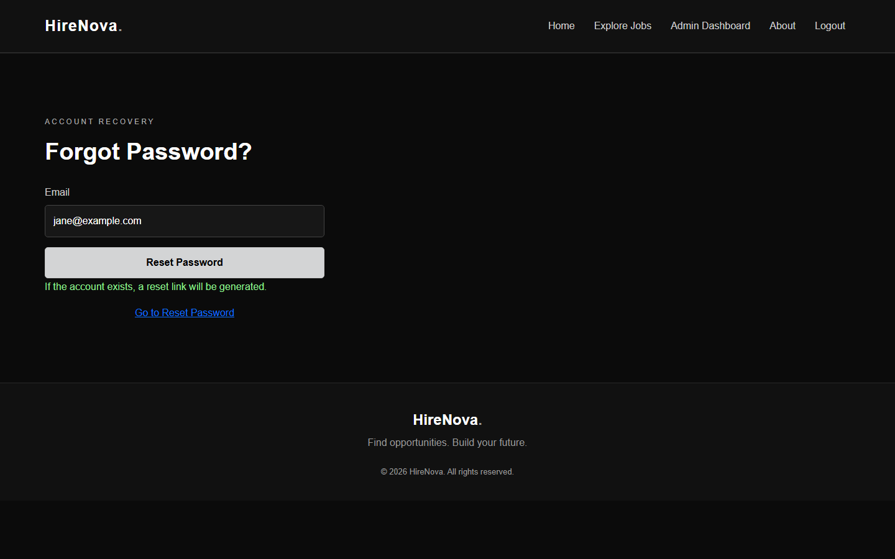 | Token-based password recovery interface. |

---

## 9. Git Branching Strategy & History

This repository is maintained using a disciplined branching strategy:

```
main (stable, production-ready releases tagged e.g. v1.0.0)
  ^
  | [Release Merge]
dev (active development & integration)
  ^
  +-- feature/database-setup  (SQLite schema, migrations, connection manager)
  +-- feature/backend-api     (Flask RESTful routes, authentication, RBAC)
  +-- feature/frontend        (Responsive SPA UI, Bootstrap templates, CSS)
  +-- feature/documentation   (Internship documentation, architecture, assets)
```

- **`main`**: Production-ready code tagged with release `v1.0.0`.
- **`dev`**: Active integration branch where features are consolidated.
- **`feature/*`**: Isolated branches for backend, frontend, database, and documentation.

---

## 10. Internship Project Submission Details

- **Project Title**: HireNova – Find Your Next Opportunity
- **Project Type**: Web Application Development (Minor Project)
- **Nature of Work**: Individual Internship Project
- **Developer**: Chethan S (`chethan.sv2006@gmail.com`)
- **Academic Year**: 2026
- **License**: MIT
