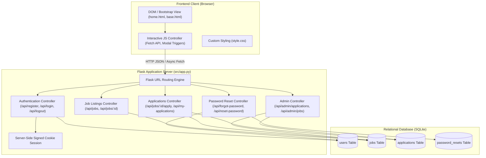
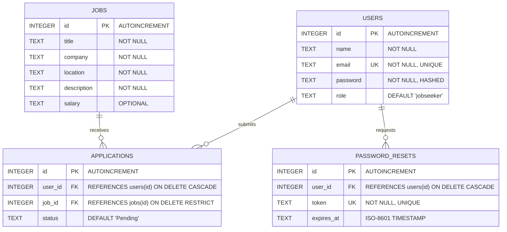
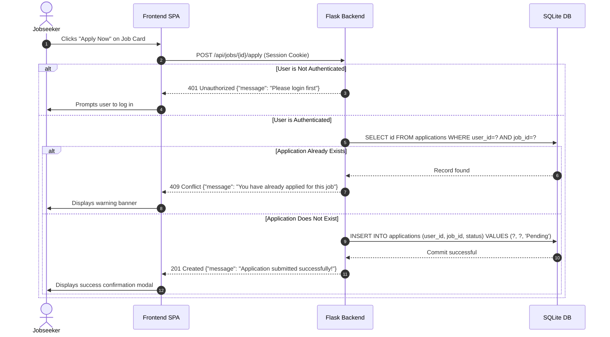
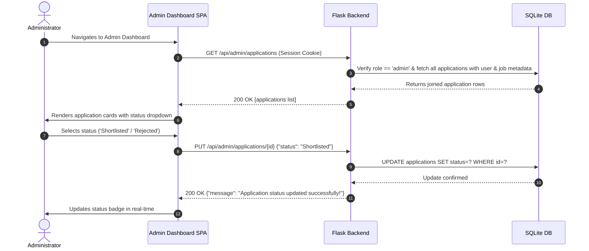

# HireNova – System Architecture & Design Specification

This document details the architectural blueprints, component interactions, database schema relationships, and runtime workflows for the **HireNova** web application.

---

## 1. High-Level System Architecture

HireNova is engineered following a clean **3-Tier Client-Server Architecture**:

```
+------------------------------------------------------------------------+
|                         Presentation Tier                              |
|   HTML5  *  CSS3  *  Bootstrap 5.3  *  Vanilla JavaScript (ES6+)       |
|                                                                        |
|  [ Single Page Application (SPA) UI ]  <--->  [ Asynchronous Fetch ]   |
+-----------------------------------+------------------------------------+
                                    |
                            HTTP / REST JSON
                                    |
+-----------------------------------v------------------------------------+
|                         Application Tier                               |
|                     Python 3.13  *  Flask 3.1                          |
|                                                                        |
|   +-------------------+  +-------------------+  +-------------------+  |
|   |   Auth Service    |  |    Jobs Service   |  | Applications Svc  |  |
|   +-------------------+  +-------------------+  +-------------------+  |
|   +-------------------+  +-------------------+  +-------------------+  |
|   |  Admin Controller |  |  Password Reset   |  | Session Manager   |  |
|   +-------------------+  +-------------------+  +-------------------+  |
+-----------------------------------+------------------------------------+
                                    |
                           SQLite Connection / SQL
                                    |
+-----------------------------------v------------------------------------+
|                            Data Tier                                   |
|               SQLite 3  *  Foreign Key Constraints                     |
|                                                                        |
|   [ users ] <----+ (1:N)                                               |
|                  |                                                     |
|                  +------ [ applications ] ------+ (N:1) ---> [ jobs ]  |
|                  |                                                     |
|   [ password_resets ] <---+ (1:1)                                      |
+------------------------------------------------------------------------+
```

---

## 2. Component Structure



---

## 3. Database Entity-Relationship (ER) Diagram



### Integrity Constraints & Rules
1. **Unique Email**: `users.email` is declared `UNIQUE` to prevent duplicate account registration.
2. **Composite Uniqueness on Applications**: `UNIQUE(user_id, job_id)` guarantees that a candidate cannot submit multiple applications for the exact same job listing.
3. **Foreign Key Cascading**: When a user is removed, associated password reset tokens and applications cascade safely.
4. **Deletion Restriction on Jobs**: Deleting a job is prohibited if applications are linked to it (`ON DELETE RESTRICT`), preventing orphan records.

---

## 4. Sequence Diagrams

### 4.1 Job Application & Duplicate Prevention Workflow



### 4.2 Admin Review & Application Status Update Workflow



---

## 5. Security & Verification Architecture

1. **Password Security**: Passwords are never stored in plaintext. Werkzeug's `generate_password_hash` uses PBKDF2/SHA256 with cryptographically strong salt.
2. **Session Security**: Session tokens are encrypted and tamper-resistant using Flask's signed cookie mechanism configured with `app.secret_key`.
3. **Role-Based Access Control (RBAC)**: All administrative endpoints (`/api/admin/*`, `POST /api/jobs`, `PUT /api/jobs/<id>`, `DELETE /api/jobs/<id>`) enforce strict verification:
   ```python
   if session.get("user_role") != "admin":
       return jsonify({"message": "Admin access required"}), 403
   ```
4. **SQL Injection Mitigation**: All database queries utilize parameterized queries (`?` placeholders) throughout `src/app.py` and `src/database.py`, preventing SQL injection vectors.
5. **Time-Limited Password Resets**: Tokens are generated via `secrets.token_urlsafe(32)` and enforce a strict 15-minute expiration timestamp with automatic invalidation upon use.
